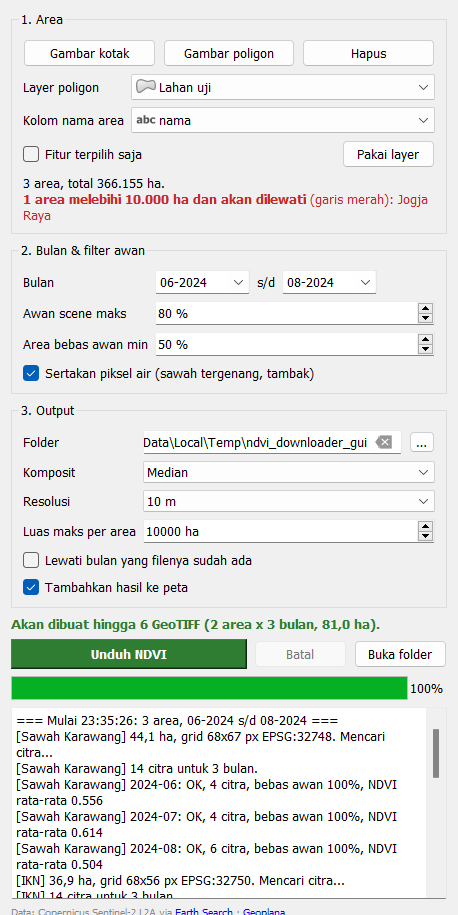

# NDVI Downloader Sentinel-2 (plugin QGIS)

Unduh **GeoTIFF NDVI komposit bulanan** dari Sentinel-2 untuk setiap area: satu file per area per bulan. Area bisa digambar di peta atau diambil dari layer poligon (setiap fitur = satu area). Area yang melebihi **batas luas maksimum** langsung dilewati.



## Fitur

- **Banyak area sekaligus**: pakai layer poligon (semua fitur atau fitur terpilih, maks. 500), nama area diambil dari kolom pilihan Anda. Bisa juga gambar kotak/poligon langsung di peta.
- **Epok per bulan**: setiap bulan dibuat komposit per piksel dari semua citra bulan itu: **Median** (paling tahan sisa awan), **Maksimum/MVC** (kehijauan puncak), atau **Rata-rata**.
- **Batas luas maksimum** (default 10.000 ha): area yang lebih besar ditandai merah di peta dan dilewati tanpa diunduh.
- **Masker awan per piksel** dengan Scene Classification Layer (awan, bayangan awan, cirrus, salju dibuang). Bulan yang area bebas awannya di bawah ambang (default 50%) dilewati.
- **Tanpa akun dan tanpa API key**: data dari katalog STAC publik [Earth Search](https://earth-search.aws.element84.com/v1) (Element 84, AWS Open Data). Hanya piksel di dalam area yang dibaca dari Cloud-Optimized GeoTIFF.
- **Lanjutkan proses**: bulan yang filenya sudah ada bisa dilewati, jadi proses yang terputus tinggal dijalankan ulang.
- **CSV ringkasan** untuk setiap run: status tiap area dan bulan (berhasil, terlalu berawan, tidak ada citra, area terlalu besar), jumlah citra, persen bebas awan, dan NDVI rata-rata.
- Hasil bisa langsung **ditambahkan ke peta** dengan gradasi warna NDVI (merah → kuning → hijau), dikelompokkan per area.

## Output

```
<folder output>/
  Sawah_Karawang/
    NDVI_Sawah_Karawang_2024-06.tif
    NDVI_Sawah_Karawang_2024-07.tif
  IKN/
    NDVI_IKN_2024-06.tif
  ringkasan_ndvi_20261102_233631.csv
```

- GeoTIFF float32 satu band, nilai NDVI −1 sampai 1, **nodata −9999** (di luar poligon, atau piksel tanpa observasi bebas awan sepanjang bulan itu).
- CRS **UTM lokal** area tersebut (mis. EPSG:32748 untuk Jawa Barat, 32750 untuk Kalimantan Timur), grid dikunci ke kelipatan resolusi (10/20/30/60 m).
- Kompresi DEFLATE. Metadata file berisi nama area, bulan, metode komposit, jumlah citra, persen bebas awan, dan ID citra sumber.

## Instalasi

1. Buat paket: `python scripts/package.py` (hasilnya `dist/ndvi_downloader-0.1.0.zip`).
2. Di QGIS buka *Plugins → Manage and Install Plugins → Install from ZIP*, pilih ZIP tersebut.

Alternatif: `python scripts/install_dev.py` menyalin plugin ke profil QGIS `default`. Restart QGIS lalu centang plugin di tab *Installed*. Gunakan terminal biasa (Command Prompt), bukan shell yang ter-sandbox.

Kebutuhan: QGIS 3.22 atau lebih baru. Tidak ada dependensi tambahan.

## Cara pakai

1. Buka panel dari menu *Raster → NDVI Downloader Sentinel-2* atau ikon di toolbar Raster.
2. **Area**: pilih layer poligon dan kolom nama, centang/hilangkan *Fitur terpilih saja*, lalu klik *Pakai layer*. Atau klik *Gambar kotak* / *Gambar poligon*. Area yang melebihi batas langsung tampil merah.
3. **Bulan**: pilih bulan awal dan akhir, atur *Awan scene maks* dan *Area bebas awan min*.
4. **Output**: pilih folder, metode komposit, resolusi, dan *Luas maks per area*.
5. Klik **Unduh NDVI**. Progres dan log per bulan tampil di panel. Proses berjalan di latar belakang dan bisa dibatalkan.

### Tips

| Kebutuhan | Setelan yang disarankan |
|---|---|
| Fase tanam padi/jagung per bulan | Komposit **Median**, 10 m, sertakan piksel air |
| Kehijauan puncak / biomassa | Komposit **Maksimum (MVC)** |
| Wilayah sangat berawan (Kalimantan, Papua, musim hujan) | *Awan scene maks* 90 %, *Area bebas awan min* 30 % |
| Banyak area atau area luas | Resolusi 20–30 m, naikkan batas luas seperlunya |

Sebagai gambaran, 2 area kecil (±40 ha) × 3 bulan selesai sekitar 1 menit. Waktu proses kira-kira sebanding dengan jumlah citra (±0,7 detik per citra per area kecil dengan koneksi rumahan).

## Cara kerja

```
untuk setiap area:
  luas (ha, di UTM lokal) > batas?  ──► lewati, catat di ringkasan
  grid UTM lokal, dikunci ke resolusi ──► masker poligon
  STAC search Earth Search per tahun (filter awan scene)
  buang item tanpa COG publik + duplikat; per tanggal cukup 1 tile bila sudah menutupi area
  untuk setiap bulan:
    tiap citra: warp B04, B08, SCL ke grid ──► masker SCL ──► NDVI (NaN jika berawan)
    komposit per piksel (median / max / mean)
    % area bebas awan < ambang? ──► lewati
    tulis GeoTIFF
```

Catatan teknis (sama dengan plugin NDVI Time Series):

- **Offset reflektan**: metadata Earth Search kadang mencantumkan offset −0,1 yang sebenarnya sudah diterapkan di piksel. Plugin mencocokkan metadata dengan nilai DN agar NDVI tidak melonjak ke 1.
- **Pencarian per tahun** untuk menghindari HTTP 502 dari Earth Search pada rentang panjang.
- **NumPy**: piksel dibaca/ditulis dengan `ReadRaster`/`WriteRaster` + `numpy.frombuffer`, bukan `gdal_array`, supaya tetap jalan walau ada NumPy versi lain di user site-packages.

## Struktur repo

```
ndvi_downloader/          folder plugin (yang masuk ke ZIP)
  __init__.py, plugin.py  entry point, menu, toolbar
  dock.py                 panel utama, styling layer
  map_tools.py            alat gambar kotak/poligon
  task.py                 QgsTask latar belakang
  core/stac.py            pencarian STAC Earth Search
  core/raster.py          grid UTM, baca COG ke grid, NDVI per citra, tulis GeoTIFF
  core/composite.py       komposit bulanan per area, batas luas, ringkasan CSV
tests/test_core.py        unit test offline
scripts/smoke_test.py     uji core dengan data asli (tanpa GUI)
scripts/gui_check.py      uji plugin headless dengan data asli + screenshot
scripts/package.py        buat ZIP rilis
scripts/install_dev.py    pasang ke profil QGIS
```

## Pengujian

```bash
"C:\Program Files\QGIS 3.40.11\bin\python-qgis-ltr.bat" -m unittest discover tests -v
"C:\Program Files\QGIS 3.40.11\bin\python-qgis-ltr.bat" scripts/smoke_test.py
"C:\Program Files\QGIS 3.40.11\bin\python-qgis-ltr.bat" scripts/gui_check.py
```

## Batasan

- Data Sentinel-2 L2A tersedia mulai 2017 (cakupan Indonesia makin rapat mulai 2018–2019).
- Di musim hujan banyak bulan bisa terlewati karena awan; turunkan *Area bebas awan min* bila tetap butuh file (piksel berawan tetap bernilai nodata).
- Masker SCL tidak sempurna; tepi awan tipis bisa lolos. Komposit median paling tahan terhadap hal ini.

## Lisensi & atribusi

GPL-2.0-or-later (lihat `LICENSE`). Mengandung data Copernicus Sentinel yang dimodifikasi, diakses melalui Earth Search oleh Element 84.

Dibuat oleh **Geoplana**. Solusi geospasial cepat, murah, dan gak ribet. [geoplanaid.github.io](https://geoplanaid.github.io) · geoplana.id@gmail.com · IG [@geo.plana_id](https://instagram.com/geo.plana_id)
